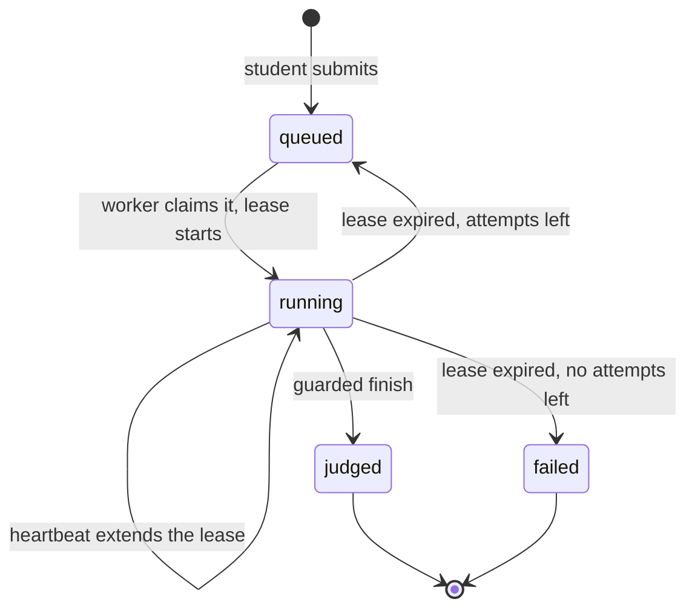
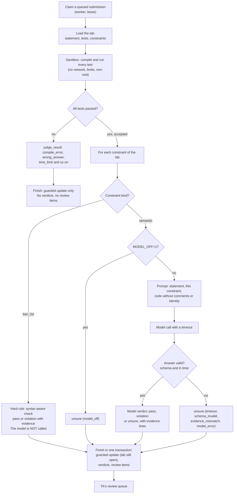

# LeeTKOB architecture

This document describes how LeeTKOB is built: the processes, the SQLite schema, the worker queue, the judging pipeline and the HTTP API. It is the design for PA#3. Most of it is **not built yet**: today the repository has the API skeleton (`GET /health` and `POST /labs/{labId}/publish`) and an in-memory store. Every part below is marked (built) or (planned) so that the plan is not mistaken for the code.

Where this document and a file in `docs/contract/` disagree, the contract wins. The rule in `AGENTS.md` is that behaviour is defined contract-first, in its own commit, before the code and the tests. Every endpoint below that is not built needs its own contract file before it is implemented.

Related files: the reasons and trade-offs behind the choices are in `docs/DECISIONS.md`, the pictures of the system (C4 levels 1 and 2) are in `docs/c4/`, the publish contract is `docs/contract/publish-lab.md`, and what the coding assistant may do is in `docs/PERMISSIONS.md`.

## 1. Principles

These come from the class brief (sections 3 and 5) and from `AGENTS.md`. The design below exists to make each of them hard to break.

- Hard rules decide the ban-list constraints. When a hard rule decides a constraint, the model is not called for it.
- The model judges only the semantic constraints. It returns `pass`, `violation` or `unsure` with evidence lines, and nothing else. It never sets a deduction: the TA sets it when the lab is created.
- Verdicts are visible in one place only, the TA's review queue. Before Publish a student sees test results and never a verdict (FAQ-08). Nothing in this build turns a verdict into a published mark.
- Publish refuses while any review item is pending, and while any submission of the lab is queued or running.
- Student code runs only in the sandbox. The sandbox has no network, no secrets, no host mounts and no Docker socket.
- The model receives the statement, one constraint, and the code without comments or identity. Nothing else.
- An answer from the model that fails the schema, or does not arrive in time, becomes `unsure`.
- A student cannot flood the queue: a submission is refused with 429 when the student already has too many pending or recent ones (section 6.6). The limits slow a flood down and never cap the number of submissions.
- Every error is `application/problem+json`, sent through `sendProblem`.

### 1.1 Which source wins

When two sources disagree, this is the order. It is also decision 17 in `docs/DECISIONS.md`.

- The lecturer comes first: the class brief, the rubrics, and the published dev set with `eval.mjs`. The brief itself says that it wins over the FAQ.
- The product owners' FAQ comes second, where the brief is silent (brief section 8). The PA#3 rubric (criterion 5) also says that what a student sees before publishing follows the FAQ, and that the entry must be cited. Entries are cited in this file as FAQ-nn.
- The team's own choices come last (`docs/DECISIONS.md`).

How each FAQ entry that touches the design is used:

| Entry                         | What it decides                                                                                                                         | How we use it                                                                                                                                                       |
| ----------------------------- | --------------------------------------------------------------------------------------------------------------------------------------- | ------------------------------------------------------------------------------------------------------------------------------------------------------------------- |
| FAQ-02, per-test results      | A student sees the overall and per-test result, never the test input or output.                                                         | Applied. `judge_detail` holds per-test results without input or output.                                                                                             |
| FAQ-02, number of submissions | A student may submit any number of times before the deadline.                                                                           | Kept. There is no cap on the count. The limits in section 6.6 only slow a flood down.                                                                               |
| FAQ-02, the last submission   | Only the last submission before the deadline is graded and reviewed.                                                                    | Not applied in PA#3. The rubric walk-through submits three solutions and expects the queue to show each, so every Accepted submission is reviewed.                  |
| FAQ-04                        | A submission that is not Accepted gets no constraint review.                                                                            | Applied. It matches the brief: only Accepted submissions are reviewed. Manual scores come later.                                                                    |
| FAQ-05                        | Default limits and ranges: CPU 1 to 5 s, memory 64 to 512 MB, 64 KB of code, 16 processes, 1 MB of output, compile 10 s.                | Applied in the schema and in section 5.4. Output over the limit is reported as `runtime_error`, which is our mapping.                                               |
| FAQ-06                        | A student sees every constraint and its deduction from the day the lab opens.                                                           | Applied.                                                                                                                                                            |
| FAQ-08                        | Before Publish a student sees only test results. After Publish, each deduction with its evidence.                                       | Applied before Publish. The view after Publish belongs to PA#5. The rubric (criterion 5) asks for this citation.                                                    |
| FAQ-09                        | For an unsure the TA must choose pass or violation. A violation needs evidence. No Publish while an unsure item remains.                | Applied. The TA ends a review item with a final verdict.                                                                                                            |
| FAQ-10                        | The queue gets every violation, every unsure and 10% of the passes (rounded up, at least one). A TA can change any verdict, with a log. | In part. The brief requires the sample, so each pass is drawn with a 10% chance. The rounding and the change log are later.                                         |
| FAQ-11                        | A deduction comes only from the constraint, once per constraint and submission, floor at 0.                                             | Applied. No verdict or review item has a deduction column.                                                                                                          |
| FAQ-12                        | Publish needs the deadline passed and no undecided item. No un-publish. Later changes need a reason.                                    | In part. The deadline is optional because the lecturer's walk-through creates a lab without one. We add that Publish also waits for queued and running submissions. |
| FAQ-03, 07, 13, 14            | Late work, edits of constraints, appeals and their limits.                                                                              | Later. Not part of PA#3.                                                                                                                                            |

Two points need the lecturer's answer, because the rubric is silent: whether the review queue must show every submission of a student or only the last one, and whether a lab must have a deadline. Until the answer comes, the lecturer's walk-through decides: every Accepted submission is reviewed, and the deadline is optional.

## 2. System architecture

### 2.1 Components

| Component       | Status       | Responsibility                                                                                                                                              | Talks to                          |
| --------------- | ------------ | ----------------------------------------------------------------------------------------------------------------------------------------------------------- | --------------------------------- |
| API server      | partly built | Accounts and roles, labs, submissions, the review queue and Publish. Writes jobs into the database. Never runs student code and has no Docker access.       | Database                          |
| Database        | planned      | One SQLite file in WAL mode. Holds accounts, labs, the job queue, verdicts, review items, publications and idempotency keys.                                | API server, judge worker          |
| Judge worker    | planned      | A separate process. Claims a queued submission, runs the judging pipeline and stores the verdicts in one transaction.                                       | Database, sandbox, model provider |
| Sandbox         | planned      | One short-lived Docker container per run. Compiles and runs student code with the nine minimums of the brief.                                               | Judge worker, through docker run  |
| Checker command | planned      | One command: a dataset folder in, a predictions file out, and a call log when the model is on. Same hard rules and model client as the worker, no database. | Model provider, dataset folder    |
| Model provider  | external     | Google Gemini API. Judges the semantic constraints and returns pass, violation or unsure with evidence lines.                                               | Judge worker, checker command     |

### 2.2 Source layout (proposed)

```text
src/
  server.ts            API entry point (built)
  app.ts               Fastify app factory (built)
  problems.ts          problem+json types and sendProblem (built)
  store.ts             in-memory store (built, replaced by db/)
  routes/              one file per endpoint group (health and publish built)
  db/                  connection, schema.sql, migrations, queries
  worker.ts            judge worker entry point
  judge/
    pipeline.ts        judges one claimed submission
    sandbox.ts         wraps docker run
    hard-rules.ts      syntax-aware ban-list rules
    model.ts           ModelClient interface, real client, fake client for tests
    guardrails.ts      schema check, timeout, mapping evidence to original lines
  checker/
    cli.ts             dataset folder in, predictions file out
```

`judge/hard-rules.ts`, `judge/model.ts` and `judge/guardrails.ts` are shared by the worker and the checker, so the checker that the lecturer runs behaves like the product.

### 2.3 Runtime and trust boundaries

- One host with Docker runs everything. The API and the worker are two processes (for example two containers of one image) that open the same SQLite file on a shared volume.
- Only the worker can reach Docker, because it starts the sandbox containers. The API has no Docker access. The sandbox containers are not given the Docker socket.
- The model API key exists only in the environment of the worker and the checker. It is never passed to the sandbox, never put in a prompt and never committed.
- Student code is untrusted. It is compiled and run only inside the sandbox, and its output is read as data.
- Prompts treat the student's code as data: it is delimited, and the model's answer must pass a strict schema, so an instruction hidden in a comment or a string cannot add a field or set a deduction.
- The API reads and writes the database only through short transactions. Reads followed by writes use `BEGIN IMMEDIATE`, so two processes cannot interleave a check and an update.

### 2.4 Configuration

| Variable                | Used by                  | Status          | Meaning                                                                           |
| ----------------------- | ------------------------ | --------------- | --------------------------------------------------------------------------------- |
| `PORT`                  | API server               | built           | Listen port. Default 3000.                                                        |
| `HOST`                  | API server               | built           | Listen address. Default 127.0.0.1.                                                |
| `DB_PATH`               | API server, judge worker | planned         | Path of the SQLite file. It must be on a volume that both processes can open.     |
| `SUBMIT_MAX_PENDING`    | API server               | planned         | Most queued or running submissions one student may have. Default 15.              |
| `SUBMIT_MAX_PER_MINUTE` | API server               | planned         | Most submissions one student may make in 60 seconds. Default 30.                  |
| `LLM_API_KEY`           | judge worker, checker    | in .env.example | Model API key. Never passed to the sandbox.                                       |
| `LLM_MODEL`             | judge worker, checker    | in .env.example | Model name. Not chosen yet.                                                       |
| `MODEL_OFF`             | judge worker, checker    | planned         | `1` means no model call and no network: every semantic constraint becomes unsure. |
| `MODEL_TIMEOUT_MS`      | judge worker, checker    | planned         | Time one model call may take. Default 20000.                                      |
| `WORKER_ID`             | judge worker             | planned         | Written to `locked_by`, so a worker can tell its own jobs.                        |
| `LEASE_SECONDS`         | judge worker             | planned         | How long a claim lasts without a heartbeat. Default 60.                           |
| `MAX_ATTEMPTS`          | judge worker             | planned         | Claims before a submission is marked failed. Default 3.                           |
| `SANDBOX_IMAGE`         | judge worker             | planned         | Docker image with g++ used for every run.                                         |

The defaults are proposals. `.env.example` lists the variables without values. Real values live only in `.env` (git-ignored) and in CI secrets.

## 3. SQLite schema

The schema below is the whole database. Notes on how it is meant to be read:

- Ids that clients see (labs, submissions, users) are opaque text, for example UUIDs. Internal rows use integer ids.
- Timestamps are ISO 8601 UTC text, so they sort and compare as text.
- Lists (`banned_names`, `evidence`) are JSON text. The API parses them; SQL does not need to.
- The database enforces the rules that must never be broken, so a bug in the code cannot store them: a violation always has evidence, a verdict that fell back always has a reason, one verdict per submission and constraint, one publication per lab, a running submission always has a lock.
- `submissions` is the queue. There is no separate jobs table, so creating a submission and queueing it is one insert.
- Neither a verdict nor a review item has a deduction column. The deduction is `lab_constraints.deduction`, set by the TA when the lab is created, and a constraint is deducted at most once per submission (FAQ-11). The TA's review ends in a final verdict, `pass` or `violation`, with evidence for a violation (FAQ-09).
- No free text from the model is stored. `model_calls` keeps what was sent, the provider's request id, the cost and whether the answer passed the schema check.
- The limits on how fast a student can submit are counted from `submissions` itself (section 6.6), with the index on `(student_id, created_at)`. There is no extra table.
- `labs.deadline` is optional. `NULL` means no deadline, because the lecturer's walk-through creates a lab with only a statement, tests and constraints. FAQ-12 is applied in part (section 1.1).
- The limits of a lab follow FAQ-05: CPU time per test 1 to 5 seconds (default 1) and memory 64 to 512 MB (default 256). Both ranges are `CHECK`s, so a lab cannot ask for more than the sandbox is meant to allow, and a memory attack of 1 GiB always meets a limit.

```sql
-- LeeTKOB database schema (SQLite). Timestamps are ISO 8601 UTC text, so they sort as text.
-- Every connection runs these three pragmas first.
PRAGMA foreign_keys = ON;
PRAGMA journal_mode = WAL;
PRAGMA busy_timeout = 5000;

CREATE TABLE schema_migrations (
  version    TEXT PRIMARY KEY,
  applied_at TEXT NOT NULL DEFAULT (strftime('%Y-%m-%dT%H:%M:%fZ', 'now'))
);

-- Accounts and classes ------------------------------------------------------

CREATE TABLE users (
  id            TEXT PRIMARY KEY,
  email         TEXT NOT NULL UNIQUE COLLATE NOCASE,
  display_name  TEXT NOT NULL,
  role          TEXT NOT NULL CHECK (role IN ('admin', 'ta', 'student')),
  password_hash TEXT NOT NULL,
  created_at    TEXT NOT NULL DEFAULT (strftime('%Y-%m-%dT%H:%M:%fZ', 'now'))
);

-- Only the SHA-256 of a bearer token is stored, never the token.
CREATE TABLE sessions (
  token_hash TEXT PRIMARY KEY,
  user_id    TEXT NOT NULL REFERENCES users (id) ON DELETE CASCADE,
  created_at TEXT NOT NULL DEFAULT (strftime('%Y-%m-%dT%H:%M:%fZ', 'now')),
  expires_at TEXT NOT NULL
);

CREATE TABLE classes (
  id         TEXT PRIMARY KEY,
  name       TEXT NOT NULL UNIQUE,
  created_at TEXT NOT NULL DEFAULT (strftime('%Y-%m-%dT%H:%M:%fZ', 'now'))
);

-- TAs and students belong to classes; a lab belongs to one class.
CREATE TABLE class_members (
  class_id TEXT NOT NULL REFERENCES classes (id) ON DELETE CASCADE,
  user_id  TEXT NOT NULL REFERENCES users (id) ON DELETE CASCADE,
  PRIMARY KEY (class_id, user_id)
);
CREATE INDEX idx_class_members_user ON class_members (user_id);

-- Labs, their tests and their constraints ----------------------------------

-- deadline is optional: NULL means no deadline, so a lab can be created with only a
-- statement, tests and constraints. CPU time per test is 1 to 5 s and memory is 64 to
-- 512 MB, the ranges of FAQ-05 (wall time is 3 times the CPU time, set by the worker).
CREATE TABLE labs (
  id              TEXT PRIMARY KEY,
  class_id        TEXT NOT NULL REFERENCES classes (id),
  title           TEXT NOT NULL,
  statement_md    TEXT NOT NULL,
  deadline        TEXT,
  time_limit_ms   INTEGER NOT NULL DEFAULT 1000 CHECK (time_limit_ms BETWEEN 1000 AND 5000),
  memory_limit_mb INTEGER NOT NULL DEFAULT 256 CHECK (memory_limit_mb BETWEEN 64 AND 512),
  status          TEXT NOT NULL DEFAULT 'open' CHECK (status IN ('open', 'published')),
  created_by      TEXT NOT NULL REFERENCES users (id),
  created_at      TEXT NOT NULL DEFAULT (strftime('%Y-%m-%dT%H:%M:%fZ', 'now'))
);
CREATE INDEX idx_labs_class ON labs (class_id);

CREATE TABLE lab_tests (
  id              INTEGER PRIMARY KEY,
  lab_id          TEXT NOT NULL REFERENCES labs (id) ON DELETE CASCADE,
  position        INTEGER NOT NULL,
  input           TEXT NOT NULL,
  expected_output TEXT NOT NULL,
  UNIQUE (lab_id, position)
);

-- kind is set by code when the TA saves the constraint: a text that starts with
-- "Do not use" or "Do not call" is a ban list, and the banned names are the
-- backticked names in the text. The deduction is the TA's number, never the model's.
CREATE TABLE lab_constraints (
  id           INTEGER PRIMARY KEY,
  lab_id       TEXT NOT NULL REFERENCES labs (id) ON DELETE CASCADE,
  code         TEXT NOT NULL,
  text         TEXT NOT NULL,
  kind         TEXT NOT NULL CHECK (kind IN ('ban_list', 'semantic')),
  banned_names TEXT NOT NULL DEFAULT '[]',
  deduction    INTEGER NOT NULL CHECK (deduction >= 0),
  UNIQUE (lab_id, code),
  CHECK (kind = 'ban_list' OR banned_names = '[]')
);

-- Submissions, and the queue that judges them -------------------------------

-- judge_detail is JSON text: the compiler message for a compile_error, otherwise one entry
-- per test with its result and time, never the test input or output (FAQ-02).
-- Output over the limit is reported as runtime_error (our mapping of FAQ-05).
-- The submissions table is the queue. status is the state machine of the worker:
-- queued -> running -> judged, with running -> queued and running -> failed
-- when a lease runs out.
CREATE TABLE submissions (
  id           TEXT PRIMARY KEY,
  lab_id       TEXT NOT NULL REFERENCES labs (id),
  student_id   TEXT NOT NULL REFERENCES users (id),
  source_code  TEXT NOT NULL CHECK (length(source_code) <= 65536),
  status       TEXT NOT NULL DEFAULT 'queued' CHECK (status IN ('queued', 'running', 'judged', 'failed')),
  judge_result TEXT CHECK (judge_result IN
                 ('accepted', 'wrong_answer', 'compile_error', 'runtime_error',
                  'time_limit', 'memory_limit')),
  judge_detail TEXT,
  attempts     INTEGER NOT NULL DEFAULT 0,
  locked_by    TEXT,
  lease_until  TEXT,
  created_at   TEXT NOT NULL DEFAULT (strftime('%Y-%m-%dT%H:%M:%fZ', 'now')),
  started_at   TEXT,
  finished_at  TEXT,
  CHECK ((status = 'running') = (locked_by IS NOT NULL AND lease_until IS NOT NULL)),
  CHECK ((status = 'judged') = (judge_result IS NOT NULL))
);
CREATE INDEX idx_submissions_queue ON submissions (created_at) WHERE status IN ('queued', 'running');
CREATE INDEX idx_submissions_lab_student ON submissions (lab_id, student_id);
-- Publish counts the queued and running submissions of a lab.
CREATE INDEX idx_submissions_lab_status ON submissions (lab_id, status);
-- The limits on how fast a student can submit read this student's recent rows.
CREATE INDEX idx_submissions_student_created ON submissions (student_id, created_at);

-- Model calls, verdicts and the TA's review queue ---------------------------

-- One row per call to the model: what was sent and what it cost. No free text
-- from the model is kept; only whether its answer passed the schema check.
CREATE TABLE model_calls (
  id                INTEGER PRIMARY KEY,
  submission_id     TEXT NOT NULL REFERENCES submissions (id) ON DELETE CASCADE,
  constraint_id     INTEGER NOT NULL REFERENCES lab_constraints (id),
  provider          TEXT NOT NULL,
  model             TEXT NOT NULL,
  request_id        TEXT,
  prompt            TEXT NOT NULL,
  prompt_tokens     INTEGER,
  completion_tokens INTEGER,
  latency_ms        INTEGER NOT NULL,
  cost_usd          REAL NOT NULL DEFAULT 0,
  outcome           TEXT NOT NULL CHECK (outcome IN ('ok', 'timeout', 'schema_invalid', 'error')),
  error_detail      TEXT,
  created_at        TEXT NOT NULL DEFAULT (strftime('%Y-%m-%dT%H:%M:%fZ', 'now'))
);
CREATE INDEX idx_model_calls_submission ON model_calls (submission_id);

-- One verdict per (submission, constraint). A verdict never carries a deduction.
-- evidence is a JSON array of {"line": n, "text": "..."} taken from the original source.
CREATE TABLE verdicts (
  id            INTEGER PRIMARY KEY,
  submission_id TEXT NOT NULL REFERENCES submissions (id) ON DELETE CASCADE,
  constraint_id INTEGER NOT NULL REFERENCES lab_constraints (id),
  verdict       TEXT NOT NULL CHECK (verdict IN ('pass', 'violation', 'unsure')),
  decided_by    TEXT NOT NULL CHECK (decided_by IN ('hard_rule', 'model', 'fallback')),
  reason_code   TEXT CHECK (reason_code IN ('model_off', 'timeout', 'schema_invalid', 'model_error',
                                          'evidence_mismatch', 'cost_cap', 'rule_error')),
  evidence      TEXT NOT NULL DEFAULT '[]',
  model_call_id INTEGER REFERENCES model_calls (id),
  created_at    TEXT NOT NULL DEFAULT (strftime('%Y-%m-%dT%H:%M:%fZ', 'now')),
  UNIQUE (submission_id, constraint_id),
  CHECK (verdict <> 'violation' OR evidence <> '[]'),
  CHECK ((decided_by = 'fallback') = (reason_code IS NOT NULL))
);

-- The TA's review queue. Every violation, every unsure and a sample of the passes get an
-- item. Verdicts reach nobody else. The TA ends an item with a final verdict, pass or
-- violation, never unsure (FAQ-09); a violation needs at least one evidence line.
-- There is no deduction here: it comes from lab_constraints (FAQ-11).
CREATE TABLE review_items (
  id          INTEGER PRIMARY KEY,
  verdict_id  INTEGER NOT NULL UNIQUE REFERENCES verdicts (id) ON DELETE CASCADE,
  lab_id      TEXT NOT NULL REFERENCES labs (id),
  reason      TEXT NOT NULL CHECK (reason IN ('violation', 'unsure', 'sample')),
  status      TEXT NOT NULL DEFAULT 'pending' CHECK (status IN ('pending', 'reviewed')),
  final_verdict  TEXT CHECK (final_verdict IN ('pass', 'violation')),
  final_evidence TEXT,
  note        TEXT,
  reviewed_by TEXT REFERENCES users (id),
  reviewed_at TEXT,
  created_at  TEXT NOT NULL DEFAULT (strftime('%Y-%m-%dT%H:%M:%fZ', 'now')),
  CHECK ((status = 'reviewed') = (final_verdict IS NOT NULL AND reviewed_by IS NOT NULL AND reviewed_at IS NOT NULL)),
  CHECK (final_verdict IS NOT 'violation' OR (final_evidence IS NOT NULL AND final_evidence <> '[]'))
);
CREATE INDEX idx_review_items_lab_status ON review_items (lab_id, status);

-- Publishing ----------------------------------------------------------------

-- At most one publication per lab: the primary key is the lab.
CREATE TABLE publications (
  lab_id          TEXT PRIMARY KEY REFERENCES labs (id),
  published_at    TEXT NOT NULL,
  published_by    TEXT NOT NULL REFERENCES users (id),
  marks_published INTEGER NOT NULL CHECK (marks_published >= 0),
  note            TEXT
);

-- Idempotency keys of POST /labs/{labId}/publish, scoped to (caller, lab).
-- Only 2xx answers are stored; rows are kept at least 24 hours.
CREATE TABLE idempotency_keys (
  user_id    TEXT NOT NULL REFERENCES users (id),
  lab_id     TEXT NOT NULL REFERENCES labs (id),
  idem_key   TEXT NOT NULL,
  body_hash  TEXT NOT NULL,
  status     INTEGER NOT NULL,
  body       TEXT NOT NULL,
  created_at TEXT NOT NULL DEFAULT (strftime('%Y-%m-%dT%H:%M:%fZ', 'now')),
  PRIMARY KEY (user_id, lab_id, idem_key)
);
```

How today's in-memory store (`src/store.ts`) maps to the tables:

| Today (`src/store.ts`)            | Becomes                                                                                                      |
| --------------------------------- | ------------------------------------------------------------------------------------------------------------ |
| `User.token`                      | `sessions.token_hash`, the SHA-256 of the token                                                              |
| `User.role`                       | `users.role`                                                                                                 |
| `User.classIds`                   | `class_members`                                                                                              |
| `Lab.pendingReviews`, a number    | The count of `review_items` with status `pending` for the lab, plus the lab's queued and running submissions |
| `Lab.judgedSubmissions`, a number | The count of judged submissions of the lab, copied into `publications.marks_published`                       |
| `Lab.publication`                 | One row of `publications`                                                                                    |
| The idempotency map               | `idempotency_keys`                                                                                           |

How this schema was checked: the file above was loaded into an in-memory SQLite (`node:sqlite` on Node 24.9) and exercised with 43 assertions: claim, lease expiry, reclaim, a stale worker finishing late, exactly-once verdicts, giving up after three attempts, a queued or running submission blocking Publish, a finish after Publish, releasing a job after an error, and the constraints that must refuse bad rows (a violation without evidence, a review ended with unsure, a limit outside the FAQ range). Those checks are not in the repository, and CI runs Node 22, which has not been tried. The behaviour has to be covered by tests written first (section 8). The statements use `RETURNING` and partial indexes, so they need SQLite 3.35 or later.

## 4. Worker queue state machine

The `status` column of `submissions` is the state machine. Only the worker moves a submission after it is created.



States:

| State     | Meaning                                                                                             | Who sets it                                                                             |
| --------- | --------------------------------------------------------------------------------------------------- | --------------------------------------------------------------------------------------- |
| `queued`  | Waiting for a worker.                                                                               | The API, when the submission is created. The worker, when it reclaims an expired lease. |
| `running` | A worker holds a lease (`locked_by`, `lease_until`) and is judging it.                              | The worker, by claiming.                                                                |
| `judged`  | Judging is done and `judge_result` is set. If it was accepted, its verdicts and review items exist. | The worker, by the guarded finish.                                                      |
| `failed`  | The leases ran out `MAX_ATTEMPTS` times. A failure of the system, not of the student.               | The worker, when a claim step finds it.                                                 |

Transitions:

| From      | To        | Trigger                                       | Guard                                                 | Effect                                                                         |
| --------- | --------- | --------------------------------------------- | ----------------------------------------------------- | ------------------------------------------------------------------------------ |
| (new)     | `queued`  | A student submits.                            | The lab is open and the student is in its class.      | Row inserted.                                                                  |
| `queued`  | `running` | A worker claims the oldest queued row.        | `status` is `queued`.                                 | `attempts` + 1. `locked_by`, `lease_until` and `started_at` set.               |
| `running` | `running` | Heartbeat, every quarter of the lease.        | `locked_by` is this worker and `status` is `running`. | `lease_until` moved forward.                                                   |
| `running` | `judged`  | The pipeline finished.                        | `locked_by` is this worker and `status` is `running`. | `judge_result` set. Verdicts and review items written in the same transaction. |
| `running` | `queued`  | A claim step finds `lease_until` in the past. | `attempts` is below `MAX_ATTEMPTS`.                   | `locked_by` and `lease_until` cleared.                                         |
| `running` | `failed`  | A claim step finds `lease_until` in the past. | `attempts` is at `MAX_ATTEMPTS` or more.              | `finished_at` set. `locked_by` and `lease_until` cleared.                      |

### 4.1 The statements

Every claim step runs these three statements, in this order. Reclaiming first means a crashed worker's job can be taken in the same step.

```sql
-- 1. Give up on jobs whose lease ran out too many times.
UPDATE submissions
   SET status = 'failed', locked_by = NULL, lease_until = NULL, finished_at = :now
 WHERE status = 'running' AND lease_until < :now AND attempts >= :max_attempts;

-- 2. Put back jobs whose lease ran out.
UPDATE submissions
   SET status = 'queued', locked_by = NULL, lease_until = NULL
 WHERE status = 'running' AND lease_until < :now AND attempts < :max_attempts;

-- 3. Claim the oldest queued job. One statement, so two workers cannot take the same one.
UPDATE submissions
   SET status = 'running', locked_by = :worker, lease_until = :lease_until,
       attempts = attempts + 1, started_at = COALESCE(started_at, :now)
 WHERE id = (SELECT id FROM submissions WHERE status = 'queued' ORDER BY created_at LIMIT 1)
RETURNING id, lab_id, source_code;
```

While it judges, the worker extends the lease. If this changes no row, the worker has lost the job and must drop its work without writing anything.

```sql
UPDATE submissions SET lease_until = :lease_until
 WHERE id = :id AND status = 'running' AND locked_by = :worker;
```

The finish is one transaction, guarded by the lock and by the lab still being open. This is what makes the verdicts exactly-once:

```sql
BEGIN IMMEDIATE;

UPDATE submissions
   SET status = 'judged', judge_result = :result, judge_detail = :detail,
       finished_at = :now, locked_by = NULL, lease_until = NULL
 WHERE id = :id AND status = 'running' AND locked_by = :worker
   AND EXISTS (SELECT 1 FROM labs WHERE id = submissions.lab_id AND status = 'open');
-- If this changed 0 rows, this worker lost the lease or the lab was published meanwhile:
-- ROLLBACK and write nothing.

INSERT INTO verdicts (submission_id, constraint_id, verdict, decided_by, reason_code, evidence, model_call_id)
VALUES (:id, :constraint_id, :verdict, :decided_by, :reason_code, :evidence, :model_call_id)
ON CONFLICT (submission_id, constraint_id) DO NOTHING;
-- One INSERT per constraint, only when the submission was accepted.

INSERT INTO review_items (verdict_id, lab_id, reason)
SELECT id, :lab_id, verdict FROM verdicts
 WHERE submission_id = :id AND verdict IN ('violation', 'unsure')
ON CONFLICT (verdict_id) DO NOTHING;
-- Each pass verdict is drawn with a 10 percent chance (brief section 3). A drawn one gets an item:
INSERT INTO review_items (verdict_id, lab_id, reason)
VALUES (:sampled_verdict_id, :lab_id, 'sample')
ON CONFLICT (verdict_id) DO NOTHING;

COMMIT;
```

A worker that catches an error that is not the student's (Docker is down, the sandbox image is missing, an exception in the pipeline) does not wait for the lease to run out. It releases the job at once:

```sql
UPDATE submissions
   SET status = CASE WHEN attempts < :max_attempts THEN 'queued' ELSE 'failed' END,
       locked_by = NULL, lease_until = NULL,
       finished_at = CASE WHEN attempts < :max_attempts THEN NULL ELSE :now END
 WHERE id = :id AND status = 'running' AND locked_by = :worker;
```

### 4.2 Rules and crash cases

- **Exactly once.** Two things protect the verdicts. The guarded `UPDATE` lets only the worker that holds the lease finish, and the unique key on `(submission_id, constraint_id)` refuses a second verdict. So even if a job is judged twice, one set of verdicts is stored.
- **Stop the worker, submit, start the worker.** The submission stays `queued`. The first claim after the restart takes it, and it is judged once.
- **A worker dies in the middle.** Its lease runs out. The next claim step puts the job back to `queued` (attempt 2), and another claim takes it. The dead worker's late write, if it ever comes, is refused by the guard.
- **A job that always crashes the worker.** After `MAX_ATTEMPTS` claims with a lease that ran out, it becomes `failed`. It is not retried forever, and the student sees that the system failed, not that the code was wrong.
- **An error that is not the student's.** The worker releases the job at once with the last statement above: back to `queued` while attempts are left, then `failed`. A Docker outage does not have to wait for three leases to run out.
- **Lease length.** The lease is longer than any single step (the compile limit, one test limit, one model timeout), and the worker extends it with a heartbeat while it works.
- **Review items and labs have their own small states.** A review item goes from `pending` to `reviewed`, once, by a TA. A lab goes from `open` to `published`, once, by Publish.
- **Publish reads the queue and the submissions.** See 4.3. It replaces the plain number `pendingReviews` of the in-memory store.

### 4.3 Publish

Publish is one transaction too. It refuses if any review item of the lab is pending, if any submission of the lab is `queued` or `running`, or if the lab has a deadline that has not passed (FAQ-12). A submission that is still waiting has no review item yet, so counting only the items would let Publish succeed while a submission has not even been judged.

```sql
BEGIN IMMEDIATE;

SELECT
  (SELECT COUNT(*) FROM review_items WHERE lab_id = :lab_id AND status = 'pending') AS pending_reviews,
  (SELECT COUNT(*) FROM submissions WHERE lab_id = :lab_id AND status IN ('queued', 'running')) AS unjudged;
-- If either is above 0: ROLLBACK and answer reviews-pending.
-- If the lab has a deadline in the future: ROLLBACK and refuse.

INSERT INTO publications (lab_id, published_at, published_by, marks_published)
VALUES (:lab_id, :now, :user_id, :marks_published);
UPDATE labs SET status = 'published' WHERE id = :lab_id;

COMMIT;
```

Because the finish checks that the lab is open, a submission that is judged after this transaction writes nothing. Once the lab is published, new submissions are refused. A `failed` submission is not counted yet: whether it blocks Publish is an open point (section 7).

## 5. Judging pipeline

The worker runs this for one claimed submission. The checker command runs steps 5 to 7 on a dataset folder, without the database.



### 5.1 Steps

- **Step 1, claim.** The worker claims a queued submission (section 4).
- **Step 2, load the lab.** The statement, the tests and the constraints of the lab. Each constraint has a `kind`, set by code when the TA saved it: a text that starts with "Do not use" or "Do not call" is `ban_list`, and its banned names are the backticked names in the text. Anything else is `semantic`.
- **Step 3, sandbox.** The code is compiled inside the sandbox (`g++ -std=c++17 -O2`, the flags the dev set uses) and run on every test. Output is compared token by token, ignoring whitespace. The outcome is one `judge_result`: `accepted`, `wrong_answer`, `compile_error`, `runtime_error`, `time_limit` or `memory_limit`. `judge_detail` keeps the compiler message, or one entry per test with its result and time, never the test input or output (FAQ-02). The limits come from the lab (FAQ-05): CPU 1 to 5 seconds per test, wall time 3 times the CPU time, memory 64 to 512 MB, 16 processes, 1 MB of output. Output over the limit is reported as `runtime_error`.
- **Step 4, not accepted.** The worker finishes with the `judge_result` and writes no verdict and no review item. The student sees the result. Only Accepted submissions are reviewed.
- **Step 5, ban-list constraints.** `judge/hard-rules.ts` reads the code with a syntax-aware check, not a text search, and returns `pass` or `violation` with the original source lines as evidence. A banned name inside a comment or a string does not count. A function of the student's own named `sort` does not count. `<algorithm>` included only for `std::swap` does not count. The model is not called, and the verdict has `decided_by = 'hard_rule'`. If the check itself crashes, the verdict is `unsure` with reason `rule_error`, and the other constraints are still judged. How the code is parsed (a real C++ parser or a tokenizer) is not decided yet (section 7).
- **Step 6, semantic constraints.** If `MODEL_OFF=1`, the verdict is `unsure` with reason `model_off`. Otherwise the pipeline builds a prompt and calls the model with a timeout. Every call is written to `model_calls`, also when it fails.
- **Step 7, guardrails.** The answer must match the schema: a verdict of `pass`, `violation` or `unsure`, and a list of evidence lines, each with a line number and text. Any other key is refused, so the model cannot add a deduction. A `violation` without evidence is refused. Every evidence line must also match the submitted code exactly (brief section 3); if one does not, the verdict is `unsure` with reason `evidence_mismatch`. A refused answer, a timeout or a provider error gives `unsure` with reason `schema_invalid`, `timeout` or `model_error`, and `decided_by = 'fallback'`. The reason `cost_cap` is for the cost cap per lab, which is PA#4.
- **Step 8, finish.** One transaction (section 4.1) records the `judge_result`, the verdicts and the review items. A violation and an unsure always get a review item. Each pass is drawn with a 10 percent chance and, if drawn, gets one with reason `sample` (brief section 3).
- **Step 9, who sees what.** The student sees the status, the judge result and the per-test results, and the constraints with their deductions (FAQ-02, FAQ-06). Before Publish a student sees no constraint verdict (FAQ-08). The TA sees the review queue and ends each item with a final verdict (FAQ-09). The marks do not change until every item is decided, no submission of the lab is queued or running, and the TA presses Publish.

### 5.2 What the model receives

A prompt for one semantic constraint holds exactly three things: the lab statement, that one constraint, and the code with its comments removed. The comments are blanked but the line breaks are kept, so line numbers stay the same and each evidence line can be mapped back to the original text. The student's name, id and email are never in the prompt, and neither is anything from the dev set. The text of the prompt is stored in `model_calls.prompt`, so anyone can check this.

### 5.3 The checker command

The checker takes a dataset folder (`problems/<id>/statement.md`, `constraints.json`, and `solutions/<id>/<name>.cpp`) and writes one JSON line per solution and constraint:

```text
{"solution":"sort-merge/s03","constraint":"C1","verdict":"violation","evidence":[{"line":12,"text":"std::sort(a, a + n);"}]}
```

It works from `statement.md` and `constraints.json` alone, so a held-out problem needs no per-problem setting. With `MODEL_OFF=1` it runs the hard rules only, writes `unsure` for every semantic constraint and opens no network connection. When the model is on, it also writes a call log with one JSON line per call: the provider's request id, the model, the tokens, the time, the cost and the prompt. The rubric (criterion 4) asks for that log to be committed with the dev-set run, next to the predictions and the `eval.mjs` report. The checker is packaged with a Dockerfile, and `eval.mjs` from the lecturer scores its output.

### 5.4 Limits to settle

The compile limit of 10 s, the source size of 64 KB and the default test limit of 1 s come from FAQ-05. The others are proposals and are not final: one model call 20 s, a lease of 60 s with a heartbeat every 15 s, and at most 3 attempts.

## 6. API endpoints

### 6.1 Conventions

- Authentication is `Authorization: Bearer <token>`. A missing or unknown token is `unauthenticated` (401). Login (planned) issues the token.
- Bodies are JSON. Every error is `application/problem+json` with a `type` under `https://leetkob.example/problems/`. Clients branch on `type`, not on `detail`.
- A TA or student who is not in a lab's class gets `lab-not-found` (404), the same answer as for a lab that does not exist, so ids of other classes do not leak. This is the rule of the publish contract, and it applies to every endpoint that takes a lab id.
- The order of checks of the publish contract is the model for the others: media type and JSON syntax, then authentication, then role, then existence and ownership, then the rest.
- Each endpoint that is not built gets `docs/contract/<endpoint>.md` first. The shapes below are proposals, and the contract file defines them.

### 6.2 Endpoints

| Method and path                           | Who may call it                            | Purpose                                                                                               | Status              |
| ----------------------------------------- | ------------------------------------------ | ----------------------------------------------------------------------------------------------------- | ------------------- |
| `GET /health`                             | Anyone                                     | Liveness probe.                                                                                       | built               |
| `POST /auth/login`                        | Anyone                                     | Exchange an email and a password for a bearer token.                                                  | planned             |
| `POST /users`                             | Admin                                      | Create an account.                                                                                    | planned             |
| `POST /classes`                           | Admin                                      | Create a class.                                                                                       | planned             |
| `PUT /classes/{classId}/members/{userId}` | Admin                                      | Put a TA or a student in a class.                                                                     | planned             |
| `POST /classes/{classId}/labs`            | TA of the class                            | Create a lab with its statement, tests and constraints. The deadline is optional.                     | planned             |
| `GET /labs/{labId}`                       | TA or student of the class                 | Read the lab with its constraints and deductions. Only the TA gets the tests.                         | planned             |
| `POST /labs/{labId}/submissions`          | Student of the class                       | Submit C++ source. Answers 202 with a queued submission, or 429 when the student submits too fast.    | planned             |
| `GET /submissions/{submissionId}`         | The student who submitted, TA of the class | Status, judge result and per-test results. Never a verdict.                                           | planned             |
| `GET /labs/{labId}/review-queue`          | TA of the class                            | List the review items with verdict, evidence and the constraint's deduction.                          | planned             |
| `POST /review-items/{itemId}/decision`    | TA of the class                            | Decide one review item: pass or violation.                                                            | planned             |
| `POST /labs/{labId}/publish`              | TA of the class                            | Publish the marks once every review is decided and no submission is waiting. Defined by its contract. | built, on a counter |

### 6.3 Notes on the planned endpoints

- `POST /auth/login`: body `email` and `password`. Answer 200 with `token`, `expiresAt` and the user. Only the SHA-256 of the token is stored. Wrong credentials give 401.
- `POST /users` and `POST /classes`: admin only. They are how the test accounts of `PA3.md` are created (one admin, two TAs in two classes, two students in the first TA's class).
- `POST /classes/{classId}/labs`: body `title`, `statementMd`, an optional `deadline` (none by default), optional `timeLimitMs` (1000 to 5000, default 1000) and `memoryLimitMb` (64 to 512, default 256), a list of `tests` (`input`, `expectedOutput`) and a list of `constraints` (`text`, `deduction`). The answer lists each constraint with its `code`, its `kind` and its `bannedNames`, so the TA sees how the text was understood.
- `POST /labs/{labId}/submissions`: body `sourceCode`. The answer is 202 with a `submissionId` and `status` `queued`. The request returns before judging; the student polls the submission. Code over the size limit (64 KB, FAQ-05) is refused with 413 and is not stored. A submission is also refused when the lab has a deadline that has passed, or when the lab is published. A student who has too many pending or recent submissions gets 429 and nothing is stored (section 6.6).
- `GET /submissions/{submissionId}`: `status`, `judgeResult` and `judgeDetail`: the compiler message, or one entry per test with its result and time but never its input or output (FAQ-02). It never contains a verdict, evidence or a model answer.
- `GET /labs/{labId}/review-queue`: optional `status` filter (`pending` by default). Each item has the submission id, the constraint (`code`, `text`, `deduction`), the verdict, the evidence lines, the reason (`violation`, `unsure` or `sample`) and its status. It is the only place a verdict can be read.
- `POST /review-items/{itemId}/decision`: body `finalVerdict` (`pass` or `violation`), `evidence` (at least one line, required for a violation) and an optional `note`. There is no choice to leave an unsure item as it is: the TA must decide (FAQ-09). A violation costs the constraint's own deduction, once per submission, and no number is sent here (FAQ-11). After the lab is published the items are read-only, so the call is refused.
- `POST /labs/{labId}/publish`: defined by its contract, which has to change first, in its own commit. Publish refuses while a review item is pending or a submission of the lab is queued or running (`reviews-pending`), and, if the lab has a deadline, before it has passed (FAQ-12). Pressing it again changes nothing.

### 6.4 Who can see what

| Data                                      | TA of the class     | Student of the class          | Anyone else         |
| ----------------------------------------- | ------------------- | ----------------------------- | ------------------- |
| Lab statement, limits and deadline        | Read                | Read                          | Nothing (404)       |
| Constraints with their deductions         | Read and write      | Read (FAQ-06)                 | Nothing (404)       |
| Test inputs and expected outputs          | Read and write      | Never (FAQ-02)                | Nothing (404)       |
| Submission source code                    | Read                | Own submissions only          | Nothing (404)       |
| Status, judge result and per-test results | Read                | Own submissions only (FAQ-02) | Nothing (404)       |
| Verdicts, evidence and review items       | Read and decide     | Never before Publish (FAQ-08) | Nothing (404)       |
| Model call log                            | Not through the API | Not through the API           | Not through the API |

An admin manages accounts and classes and has no access to labs, submissions or verdicts.

### 6.5 Problem types

The types that exist in `src/problems.ts`:

| Type                      | Status | Title                                        |
| ------------------------- | ------ | -------------------------------------------- |
| `unsupported-media-type`  | 415    | Unsupported media type                       |
| `validation-failed`       | 422    | Request body is invalid                      |
| `unauthenticated`         | 401    | Authentication required                      |
| `forbidden-role`          | 403    | Only TAs may publish marks                   |
| `lab-not-found`           | 404    | Lab not found                                |
| `invalid-idempotency-key` | 400    | Idempotency-Key is missing or invalid        |
| `idempotency-key-reused`  | 422    | Idempotency-Key reused with a different body |
| `reviews-pending`         | 409    | Reviews are still pending                    |
| `internal`                | 500    | Internal server error                        |

The new endpoints will need more types, for example for wrong login credentials, a source file that is too large, a lab that is already published, a submission after the deadline, a Publish before the deadline, and too many submissions (429, `too-many-submissions`). Each is named, with its fixed title and status, in the contract of the endpoint that uses it.

### 6.6 Limits on submitting

Nothing else limits how often a student can submit, and FAQ-02 lets a student submit any number of times before the deadline. So these limits slow a flood down. They never cap the number of submissions (decision 19 in `docs/DECISIONS.md`).

Two checks run per student, in the same transaction that inserts the submission:

- At most `SUBMIT_MAX_PENDING` submissions of the student are `queued` or `running` (default 15). This bounds how much of the queue one account can take.
- At most `SUBMIT_MAX_PER_MINUTE` submissions of the student were created in the last 60 seconds (default 30). This bounds how fast.

When a check fails, the answer is 429 `too-many-submissions` and nothing is stored, so a refused submission does not count against the student. For the rate check the answer carries `Retry-After`, the seconds until the oldest recent submission leaves the window.

```sql
BEGIN IMMEDIATE;

SELECT
  (SELECT COUNT(*) FROM submissions
    WHERE student_id = :student_id AND status IN ('queued', 'running')) AS pending,
  (SELECT COUNT(*) FROM submissions
    WHERE student_id = :student_id AND created_at > :window_start) AS recent,
  (SELECT MIN(created_at) FROM submissions
    WHERE student_id = :student_id AND created_at > :window_start) AS oldest_recent;
-- pending at SUBMIT_MAX_PENDING or more, or recent at SUBMIT_MAX_PER_MINUTE or more:
-- ROLLBACK and answer 429. :window_start is now minus 60 seconds.

INSERT INTO submissions (id, lab_id, student_id, source_code)
VALUES (:id, :lab_id, :student_id, :source_code);

COMMIT;
```

How to read it:

- The check and the insert are one transaction, so two requests at the same moment cannot both pass when only one place is left.
- The defaults are deliberately lenient. The lecturer's walk-through submits three solutions in a row and then about ten attack submissions of the lecturer's own, possibly from one account, so the limits must stay well above that. They are environment variables and can be raised without a code change.
- The limits are per student, never global, so 80 students who submit at the same moment (the PA#5 load test) do not slow each other down.
- The size limit (413), the deadline and the state of the lab are checked before these limits, as the order of checks of the endpoint's contract will say.
- What it does not protect: login and the other routes, requests that fail before they insert, and a flood spread over many accounts. A rate-limit library, or a limit at the proxy, would cover those. The team plans to review that later (decision 19). This check stays useful then, because it counts real submissions, which a request counter cannot.

## 7. Open points

- **Publish and unjudged submissions (decided).** The publish contract counts review items only. A submission that is still `queued` or `running` has no review item, so a lab could be published while a submission has not been judged. The team decided that Publish also waits for queued and running submissions (section 4.3). That is a change to `docs/contract/publish-lab.md`, in its own commit first, and it is not made yet.
- **Titles are fixed per problem type.** `forbidden-role` is titled "Only TAs may publish marks", so the endpoints that only an admin or only a student may call need their own role types, or a more general title decided in a contract-first commit.
- **What a student may see (answered by the FAQ).** Constraints with their deductions are visible (FAQ-06). Before Publish a student sees only test results (FAQ-08). Both are applied; see section 1.1.
- **Sampling the passes.** The brief (section 3) sends a random 10% of the pass verdicts to the review queue, so it is part of the build even though the PA#3 rubric does not mark it. Each pass is drawn with a 10% chance. The FAQ adds rounding up and at least one pass per lab (FAQ-10), which needs a pass over the whole lab and is left for later.
- **Guardrails of PA#4.** The brief (section 3) asks for evidence lines that match the code exactly and a cost cap per lab. The reasons `evidence_mismatch` and `cost_cap` already exist in the schema, and the evidence check is part of step 7. The cost cap itself is PA#4.
- **Choices not made yet.** The database (SQLite is the proposal, Postgres would change the schema file only), how the hard rules read C++ (a parser such as tree-sitter, or a tokenizer), where the system is hosted (proposed: one Azure for Students VM, configured in `docs/DEPLOYMENT.md`; it needs Docker and must stay up until the PA#4 marks are out), and the model.
- **Limits on submitting (decided, to be reviewed).** The check in section 6.6 protects submissions only. Whether to add a rate-limit library or a limit at the proxy for login and the other routes is to be reviewed later (decision 19). The default numbers are a guess, kept above what the lecturer's flows need.
- **A `failed` submission (open).** It has no verdict. Recommendation: Publish refuses while one exists, until an admin requeues it or the TA gives a manual score. Not decided.
- **Two points for the lecturer (open).** The rubric is silent on whether the review queue shows every submission of a student or only the last (FAQ-02), and on whether a lab needs a deadline (FAQ-12). See section 1.1.
- **Not designed.** Deleting idempotency keys after 24 hours, deleting expired sessions, requeueing a `failed` submission by hand, the log of changed verdicts (FAQ-10), edits of constraints (FAQ-07) and appeals (FAQ-13, FAQ-14).

## 8. Tests that prove the design

Tests land before, or in the same commit as, the code they test, one part per commit.

- Sandbox: one attack submission for each of the nine minimums, run in CI on the tag.
- Queue: stop the worker, submit, start the worker, and check that one set of verdicts exists. Also a stale worker that finishes after its lease ran out, which must write nothing.
- Hard rules: the traps (own `sort`, a banned name in a comment or a string, `<algorithm>` only for `std::swap`) must not fire, and the plain and disguised violations must.
- Model call: a fake model that returns bad JSON, an extra key, or nothing in time, each of which must give `unsure`. No test uses the real model.
- Review queue: Publish refuses while an item is pending and while a submission is queued or running. A worker that finishes after Publish writes nothing. A student request never returns a verdict before Publish.
- Isolation: a TA of another class gets `lab-not-found` for the lab and for its queue.
- Submitting: with a fake clock, the 16th pending submission and the 31st submission within a minute get 429 with `Retry-After`, a refused submission is not stored, and a student near the limit does not slow another student.
- Checker: with the model on it writes a call log with the provider's request ids (a fake provider in the test), and with `MODEL_OFF=1` it opens no connection.
- Dev set: the SHA-256 of `eval.mjs` and `labels.jsonl` is pinned, so an edit turns CI red.
