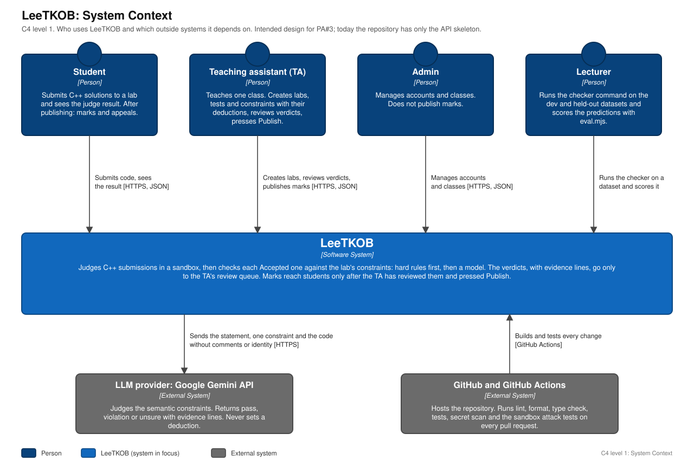
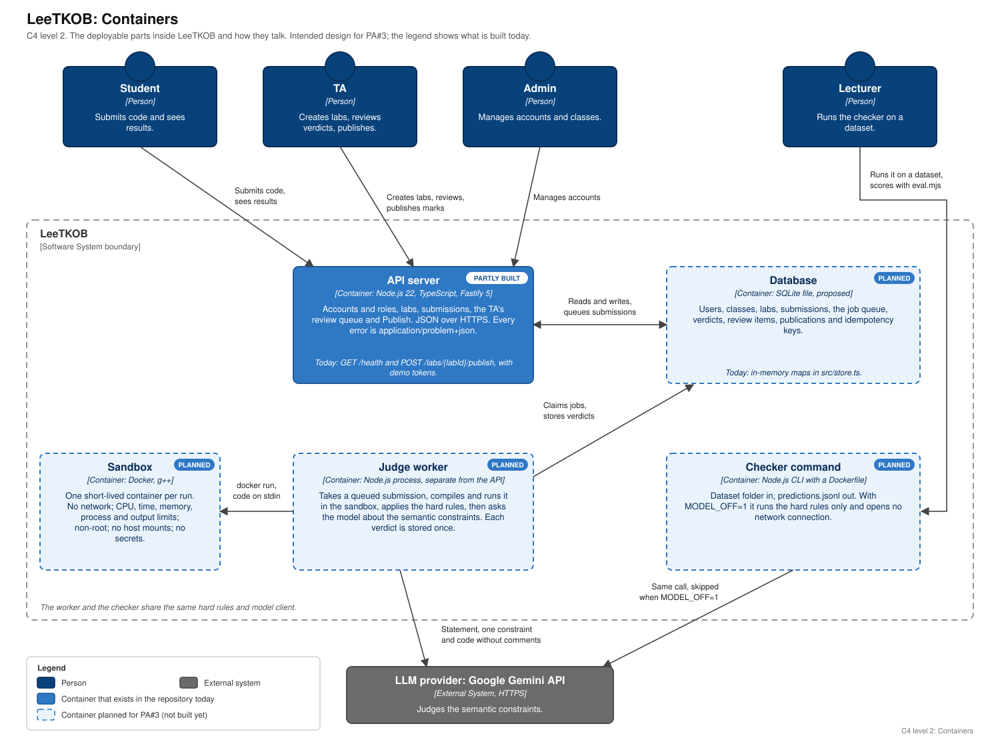

# LeeTKOB architecture overview (C4 model)

Two diagrams give the big picture of LeeTKOB: level 1 (System Context) and level 2 (Containers) of the C4 model. Both show the design intended for PA#3. Not everything is built yet, so level 2 marks what exists today and what is planned.

## Level 1: System Context

Who uses LeeTKOB and what it depends on:

- Student: submits C++ solutions to a lab and sees the judge result. After publishing, the student sees marks and can appeal.
- Teaching assistant (TA): belongs to one class. Creates labs with tests and constraints (and the deduction of each constraint), reviews the verdicts, and presses Publish.
- Admin: manages accounts and classes. Does not publish marks.
- Lecturer: runs the checker command on the dev and held-out datasets and scores the predictions with `eval.mjs`.
- Google Gemini API (external): judges the semantic constraints. It only sees the statement, one constraint, and the code without comments or identity.
- GitHub and GitHub Actions (external): hosts the repository and runs the checks on every pull request.

## Level 2: Containers

The parts inside LeeTKOB:

- API server (Node.js 22, TypeScript, Fastify 5): accounts and roles, labs, submissions, the TA's review queue and Publish. Every error is `application/problem+json`.
- Database (SQLite file, proposed): users, classes, labs, submissions, the job queue, verdicts, review items, publications and idempotency keys.
- Judge worker (separate Node.js process): takes a queued submission, compiles and runs it in the sandbox, applies the hard rules, then asks the model about the semantic constraints. Each verdict is stored once.
- Sandbox (Docker, g++): one short-lived container per run, with no network and limits on CPU, time, memory, processes and output. It runs as a non-root user, has no host mounts, and receives no secrets.
- Checker command (Node.js CLI with a Dockerfile): takes a dataset folder and writes `predictions.jsonl`. With `MODEL_OFF=1` it runs the hard rules only and opens no network connection.

The worker and the checker share the same hard rules and model client. Verdicts go only to the TA's review queue and never reach a student's mark by themselves.

## What exists today and what is planned

Built (PA#2):

- API server skeleton with `GET /health` and `POST /labs/{labId}/publish`. The contract is in [`../contract/publish-lab.md`](../contract/publish-lab.md).
- An in-memory store with demo users and labs (`src/store.ts`, `src/server.ts`). Publish counts pending reviews with a plain number, not a real queue.
- CI with lint, format check, type check, tests and a secret scan, and a protected `main` branch.

Planned (PA#3), drawn with dashed borders in the level 2 diagram:

- Database, queue and judge worker, with a real review queue behind Publish.
- Sandbox with its nine minimums and one attack test for each.
- Hard rules, the model call with schema check and timeout, and the checker command.
- A public deployment.

## Choices behind the diagram that are not final

- The database is drawn as SQLite because it is the simplest option for one host. Postgres would change only the box label.
- There is no web interface in the diagram. PA#3 is judged through the product's API.
- The sandbox is our own Docker setup. A self-hosted Judge0 would replace that box.
- The model is drawn as the Gemini API because the README names it, but the exact model is not chosen yet.

If one of these changes, update the diagram and this file in the same pull request.

## About the image files

The two `.svg` files are plain text, so Git shows readable diffs and any editor can open them. They are not formatted by Prettier or linted by ESLint.
